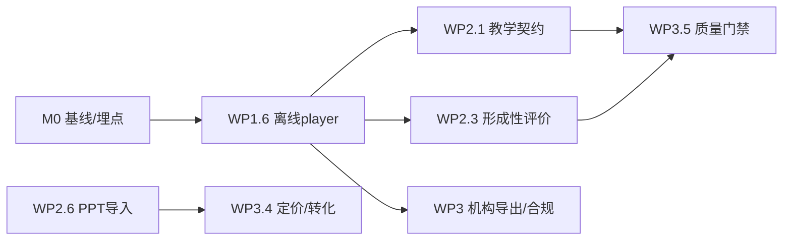

# 基于调研报告的全文分析与下一步优化计划

日期: 2026-09-27  
依据: `research/openmaic-optimization/REPORT.md` + `findings/F1–F6.md`  
定位: 决策向文档 — 逐节消化报告，落到可执行工作包

---

## 一、报告全文逐节分析（不省略）

### §1 执行摘要 — 核心矛盾

报告把产品矛盾压成一张「要 vs 有」表，五条全部成立且互相耦合：

1. **交付物**：教师要「一份离线可交互可带走的课」；现状是 PPTX / 资源包 / .maic.zip / MP4 四条分叉，维护者 wyuc 明确承认 gap 并给出 3 阶段路线（unpacked player → interactive+whiteboard → single-file）。这是**功能请求里优先级最高、且有官方路线图**的项。[10]
2. **稳定性**：互动场景 DOA、TTS 不可用 —— 直接攻击「互动课堂」这个品类卖点。[2][3]
3. **教学性**：AI 讲师答非所问（先复述 PPT）—— 用户预期是教师行为，不是朗读器。[4]
4. **可采购性**：缺 LTI/SSO/名册/报表/FERPA；欧美机构采购清单是硬门槛。[11][36][37]
5. **生成质量叙事**：竞品在卷「咨询级/研究型 PPT」，教育专项（课标、测验、讲稿、ZPD）反而是空档 —— **不该跟风卷排版，该打教育闭环**。[21][22]

**战略选择（报告结论，本文确认）：**  
`能用（P0） → 能教（P1） → 能买（P2）`；生成美观度只作 P1/P2 的增强项，不单独立项。

---

### §2 架构与代码 — 红利与利息

**红利（应继续复用，不要推倒）**

| 资产 | 含义 |
|---|---|
| 六包单向依赖 + DSL 契约 [24] | 新能力优先落在 generation/dsl，少污染 app |
| 四后端持久化契约测试 [26] | 私有化/多云是卖点，改存储不伤主链路 |
| PPTX 浏览器导出 + 独立 MP4 服务 [31] | 重负载可水平扩，降级路径清楚 |
| playclass 只 patch 2 文件 [33] | 上游升级可持续；平台功能放 platform/ |
| 775+ 测试、test:quality 进 CI [32][34] | 改动有安全网 |

**利息（优化计划必须还）**

| 热点 | 风险 | 计划中的处理 |
|---|---|---|
| scene-generator 71KB / 37 导出 [25] | 互动防护、场景类型注册表会继续加码这里 | P2 拆分；P0/P1 **只加旁路**，不重构主文件 |
| settings 105KB / session-store 95KB / instructor 93KB [30] | 会话风暴、教师策略难测 | P0 修风暴可局部改 session-store；策略抽到 skill/prompt 层 |
| 场景类型 4 处、Widget 3 处同步 [27][28] | 教育新场景（形成性评价）成本高 | P1 新场景用注册表原型，P2 正式化 |
| providers.ts 82KB [35] | TTS/ASR 集成 bug 多发区 | P0 只修关键路径；P2 按模态拆分 |
| Windows 路径/测试 [13] | 国内开发者流失 | P0 CI 加 Windows job 或文档钉死 WSL |

---

### §3 用户反馈 — 按「商业杀伤力」排序的事实

报告 3.1 七条痛点的商业含义：

1. **互动 DOA（#1622）** — 展示即翻车，转化与口碑双杀。必须 P0，验收用「坏脚本必须显示可操作错误/重生成」。
2. **TTS 不可用（#748）** — 「多模态课堂」变哑巴。P0：音色稳定性 + 失败降级字幕。
3. **生成中途失败（#595）** — 长课必踩。P0：断点/单页重试。
4. **会话风暴（#1558）** — 成本与稳定双输（6 分钟 700 请求）。P0：重试语义修正。
5. **语音/工具链脆（#1579 等）** — FormData、tool_calls、语言硬编码。P0 回归用例。
6. **MinIO/S3（#1686）** — 私有化客户直接不可用。P0 合并社区补丁。
7. **错误文案（#1646）** — 信任成本；配额耗尽不该重试。P0 小改大收益。

3.2 功能请求：**离线单文件 HTML** 是最大；机构 FERPA/多用户；provider 扩张是双刃剑（差异化 vs 集成负担）→ 计划里 provider 冻结到「质量问题修完」再扩。

3.3 表扬说明社区信任还在（白板闭环、集成、一键课堂）—— P0 是「别辜负」，P1 是「兑现教育承诺」。

---

### §4 竞品 — 两个战场的不同打法

**演示/课件生成（F2）**  
- 价格锚：Beautiful.ai $14.5、Gamma $8–15、Presentations.AI $20–50、Boardmix ¥288/年。  
- 能力趋同：自动排版、模板海、PPT I/O；开始卷「Agent 研究→成稿」。  
- **启示**：排版是入场券，不是溢价点；跟 AiPPT/Kimi 卷模板是错误战场。

**教育课堂（F3/F6）**  
- Nearpod：个人年费 $159/$397，机构 quote；LTI/SSO 锁机构。  
- Khanmigo：苏格拉底不给答案；K-12 仅学区采购 —— **安全/合规本身是产品**。  
- Curipod：可量化提分（STAAR/CAASPP）+ 课程对齐。  
- ClassPoint：$8/月，不换 PPT，按班级人数 + AI credits 墙。  
- 中国：希沃/学而思/101 走硬件/渠道/项目，**无公开 SaaS 标价**。

**结论**  
- 差异化 = **教育链路**（大纲课标、测验讲稿、ZPD、形成性评价、事实锚定）。  
- 获客 = 教师 freemium + 存量 PPT 低摩擦导入。  
- 变现 = 个人订阅（$8–15 / ¥200–400 年）+ 机构 quote（LTI/SSO/报表）。  
- 不要做的：模板站、数字人视频军备赛（除非 P2 有余力且有成本护栏）。

---

### §5 AI 教学法 — 产品必须内建的「硬规则」

报告表 5 的 7 条可直接译成产品规则：

| 证据 | 产品规则（验收口径） |
|---|---|
| 无护栏 −17% 迁移；扣答案无伤害 [47] | 默认 **Hold-answer**；「直接给解」需教师显式开 |
| 苏格拉底 > 提示词技巧 [48] | 引导策略进 system/skill，不靠用户 prompt |
| 规模≠苏格拉底 [49] | 不承诺「换更大模型就更会教」；要做策略评测 |
| 多轮失败 17.7%→77.8% [54] | 长对话**每 N 轮跑教学守卫**（泄题/放弃脚手架/强化误解） |
| RAG+校验 幻觉 4.9%、后测↑ [53] | 上传资料锚定 + 关键论断标注；抽检进质检 |
| LLM 难度低估误解题 [52] | 难度/自适应以教师标注 + 作答数据为准 |
| 位置规则：勿让任务毫不费力 [55] | 流程固定：**首次尝试 → 护栏辅导 → 无辅助检查** |

OpenMAIC skills（ZPD/PBL）方向对，缺的是 **Hold-answer / 帮助阶梯 / 多轮守卫 / 无辅助检查** 的产品化与评测。

---

### §6 商业化与集成 — 机构单清单

- **表最低**：LTI 1.3（AGS 成绩 / NRPS 名册 / Deep Linking）、SSO（Google/MS/Clever/ClassLink）、行政报表。[43][37]
- **付费墙轴**：班级人数、AI/视频额度、报告留存、品牌、Webhook/API。[36][37]
- **迁移摩擦**：已有 PPT 一键互动化 —— ClassPoint 全话术。[40]
- **导出**：PPTX/PDF/视频 + 可选 SCORM；离线 HTML。[10][42]
- **升级保护**：个人转机构按比例退 —— 降低升级阻力。[46]

playclass 已有：次数/视频/加购包/机构席位 —— **轴与竞品对齐**；缺的是集成层与报告层，不在计费本身。

---

### §7–8 优化方向与优先级图

报告 P0/P1/P2 结构正确。本文在此基础上拆成 **工作包 + 依赖 + 验收 + 里程碑**（见第二部分）。依赖顺序与 mermaid 一致：`用户可感知质量 → 教育闭环 → 商业化`。

---

### §9 Open questions — 计划里如何消化

| 缺口 | 计划动作 |
|---|---|
| 外部社区声量未测 | P0 发布后做 1 次客服/社群主动访谈（20 位教师） |
| 海外定价二级源 | P2 定价评审前人工打开官网核价 |
| 中国机构预算带 | P2 售前访谈 3–5 家学校/集成商 |
| 单文件 HTML vs /api/* | P0 立项时先做 1 天技术 spike，二选一：纯前端 runtime 内联 vs 沙箱 stub |

---

## 二、下一步优化计划（可执行）

### 里程碑总览

| 阶段 | 周期 | 目标一句话 | 出口指标（建议） |
|---|---|---|---|
| **M0 基线** | 第 0 周 | 指标能测 | DOA/TTS/生成成功率基线仪表（playclass monitor 扩展） |
| **M1 能用** | 第 1–6 周 | 课「打得开、听得见、带得走」 | 互动 DOA < 2%；TTS 成功率 > 95%；生成可恢复；离线 player 可演示 |
| **M2 能教** | 第 7–12 周 | AI 老师像老师，内容可信 | 答问直答率 ↑；Hold-answer 默认开；幻觉抽检 < 5% |
| **M3 能买** | 第 13–22 周 | 机构可签单 | LTI/SSO 试点 1 所；PPT 导入可用；报价包完整 |

---

### M0 · 质量基线（第 0 周，约 3–5 人日）

| 任务 | 验收 |
|---|---|
| 埋点：互动页运行时错误率、TTS 成功/失败、生成 job 成功/重试、导出成功 | admin 监控页可见；连续 7 天有数 |
| 固定评测集：10 门课（K12 数/语/物 + 职业课） | `eval` 可重复跑 |
| Spike：离线 player 技术路线（内联 runtime vs /api stub） | 一页技术结论，选定 M1 路线 |

---

### M1 · 能用（第 1–6 周）— 对应报告 P0

#### WP1.1 互动场景防 DOA（#1622）— 优先级 1
- 生成保存前：JS 语法 + 关键 API 白名单校验（已有 interactive-script-validator 加强）
- 播放器：iframe/组件级 ErrorBoundary + 错误面板（复制错误、一键重生成该页）
- 回归：损坏脚本 fixture 必须「可见错误」而非静默失效
- **验收**：坏脚本 100% 显示错误 UI；正常互动页启动成功率 ≥ 98%

#### WP1.2 TTS 可用（#748）
- 同课锁定单一 provider+voice；语速/断句配置进设置
- 失败自动降级字幕；UI 标明「本节语音不可用」
- 禁止同段混音色；中文课强制 zh 音色
- **验收**：评测集 TTS 成功率 ≥ 95%；无「同段混方言」投诉用例

#### WP1.3 生成可恢复（#595）
- job 级 checkpoint（大纲→场景→媒体→TTS）
- 失败页「重试本页 / 重试后续」；错误含步骤名
- **验收**：第 N 页失败可从 N 续跑；不重复扣计费（recordUsage 仅成功后）

#### WP1.4 持久化与限流卫生（#1558/#1646）
- autosave 失败退避 + 最大重建次数；禁止每 tick 建 session
- 429/配额错误 **不可重试**；错误文案本地化
- **验收**：故障注入下无 session 风暴；配额耗尽 1 次请求即停

#### WP1.5 私有化 S3（#1686）
- 合并/自实现 MinIO、自定义 endpoint、path-style
- **验收**：MinIO/R2 集成测试绿

#### WP1.6 离线交付「unpacked folder player」（#1470 阶段 1）
- 导出：`index.html + assets/` 本地可双击播放（互动 + 白板回放）
- 明确与 PPTX/MP4 并列的产品文案
- **验收**：断网 U 盘打开可完整走完一节课

**M1 明确不做**：新视频模型、模板市场、LTI、大重构 scene-generator。

---

### M2 · 能教（第 7–12 周）— 对应报告 P1 + §5 规则

#### WP2.1 AI 老师「教学契约」
- 意图路由：提问 → **直接答**；默认不整页复述
- 帮助阶梯：提示 → 半例 → 例题 → 完整解（每步教师可配）
- Hold-answer 开关（课堂默认开；作业检查场景可关）
- **验收**：人工 rubric 直答率 ≥ 80%；「先念 PPT」用例 ≤ 10%

#### WP2.2 多轮教学守卫（#54 风险）
- 每 N 轮检查：泄题、放弃脚手架、强化误解；触发则收敛为阶梯提示
- 记入 learner_events
- **验收**：长对话（20+ 轮）教学失败率 < 20%（基线先测）

#### WP2.3 形成性评价闭环
- 测验 → 错因标签 → 针对性再教 → **无辅助小测**
- dashboard：正确率、错因分布、前后测对比（playclass learner_events 扩展）
- **验收**：一门课闭环可走通；报表可导出

#### WP2.4 事实锚定（#53）
- 上传资料 RAG；关键论断页脚引用；无资料时标注「模型生成」
- 离线质检：幻觉抽检脚本进 `test:quality` 扩展
- **验收**：有资料课抽检幻觉 ≤ 5%；引用可点击

#### WP2.5 大纲难度与教师编辑
- 教师可改难度/课标标签；自适应不单信 LLM 难度（#52）
- **验收**：大纲编辑保存后生成尊重编辑

#### WP2.6 PPT 一键互动化（ClassPoint 摩擦论）
- 复用 importer：PPT → 大纲/场景草稿 → 教师确认生成
- **验收**：标准 20 页 PPT 30 分钟内得到可玩课堂草稿

---

### M3 · 能买（第 13–22 周）— 对应报告 P2 + §6

#### WP3.1 机构集成 MVP
- 顺序：Webhook 成绩/用量 JSON → Google Classroom 嵌入/名册 → LTI 1.3 AGS
- SSO：Google/Microsoft 优先（Clever 后置）
- **验收**：1 所试点校完成成绩回传

#### WP3.2 报告与留存轴
- 报告留存 1 月 / 1 年 / 终身；品牌白标；API key 权限
- 个人→机构升级保护（比例退/换算）
- **验收**：机构报价单 PDF 可生成

#### WP3.3 合规包装
- FERPA/未成年人/数据驻留说明；DPA 模板
- **验收**：销售可交付合规模块文档

#### WP3.4 定价对齐（数字见 §4）
- 教师：Pro **$8–15/月** 或 **¥199–399/年**；AI/视频点数独立（playclass 加购包已具备）
- 机构：quote + 席位；中国渠道价另表
- **验收**：定价页 + 购买/发票流程完整

#### WP3.5 发布质量门禁
- DOA、TTS 成功率、答问直答率、幻觉抽检进 release checklist + CI（LLM 评测有密钥时）
- **验收**：不达标不得发版

#### WP3.6 架构减负（穿插，每周 ≤ 1 天）
- 场景类型注册表；拆 providers.ts 按模态；session-store 拆 autosave
- **验收**：新增场景类型改动点 ≤ 2 处；核心文件 < 40KB

---

### 依赖关系

### 风险与对策

| 风险 | 对策 |
|---|---|
| 上游 OpenMAIC 合并冲突 | 业务改动优先 skill/prompt/platform；跨 lib 的补丁记入 patch 清单 |
| 单文件 HTML 工程过重 | M0 spike 定界；先交付 unpacked player |
| Hold-answer 影响「满意度」 | 教师开关 + 课后无辅助测；用学习数据说话 |
| LTI 范围膨胀 | 先 Webhook + 嵌入，LTI 只做 AGS |
| 只修 bug 不做教育闭环 | M2 入口指标进 OKR；P0 超 6 周则砍 P2 |

### 建议 OKR（季度）

- **O1 课能用**：互动 DOA < 2%；TTS 成功率 > 95%；离线 player 交付 10 位种子教师
- **O2 课能教**：直答率 ≥ 80%；20 轮对话教学失败 < 20%；有资料课幻觉 ≤ 5%
- **O3 课能买**：1 所试点校；教师付费转化 ≥ 5%（freemium→Pro）

---

## 三、本周即可启动的 5 件事

1. 建 **质量基线脚本**（互动 DOA / TTS / 生成成功率）→ 挂 admin 监控  
2. **WP1.1**：互动播放器 ErrorBoundary + 坏脚本 fixture 测试  
3. **WP1.4**：session autosave 退避 + 429 不重试  
4. **M0 spike**：离线 player 1 天技术结论  
5. 评测集 10 门课冻结进 `eval/`  

---

*本文是执行计划；证据细节见 `findings/F1–F6.md` 与 `REPORT.md`。*
