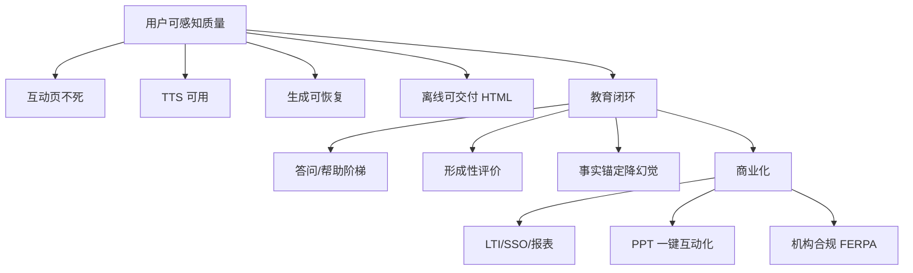

# OpenMAIC / playclass 优化调研报告

日期: 2026-09-27  
范围: 代码架构 · 用户反馈 · 竞品 · AI 教学法 · 商业化  
工作区: `research/openmaic-optimization/`

---

## 1. 执行摘要

OpenMAIC（清华 THU-MAIC）是一个**技术底座很强、教育闭环未完成**的多智能体互动课堂引擎：39.2k star、六包清晰架构、775+ 测试、PPTX/MP4/在线课堂三种交付。[1][24]

但从**商业化产品**看，最大矛盾是：

| 用户真正要的 | 现状 |
|---|---|
| 一份可离线、可交互、可交付的课 | 导出四分叉，维护者承认 “the gap is real” [10] |
| 稳定可用的互动页 / 语音 | 互动页「能看不能点」、TTS 不稳是最高频抱怨 [2][3] |
| 像真老师一样答疑 | 提问后先复述 PPT，教学法路由不对 [4] |
| 学校/机构能采购 | 缺 LTI/SSO/名册/报表/FERPA；个人 freemium 才是入口 [11][36][37] |
| 课件生成质量对标「咨询级」 | Gamma/Kimi/AiPPT 在卷「研究型 PPT」，教育专项链路反而是空档 [21][22] |

**结论：优先修「能用」，再打「教育闭环」，最后才卷「生成更漂亮」。**

---

## 2. 架构与代码现状

### 2.1 做得好的

- **包边界干净**：`@openmaic` 六包单向依赖，DSL 为唯一契约层；storage→dsl only。[24]
- **持久化可插拔**：Browser / HTTP / PG / S3 四后端共享契约测试，新后端只实现接口。[26]
- **导出与渲染分离**：PPTX 在浏览器；MP4 走独立 render-service（Hyperframes + Chromium + FFmpeg）。[31]
- **平台层隔离**（playclass）：上游合并仅 patch `middleware.ts` + `with-owner.ts`，63 处 ownerId 自动多租户。[33]
- **可测试性**：775 测试文件 + 包内 142；离线质检 `test:quality` 已进 CI。[32][34]

### 2.2 复杂度热点 / 技术债

| 位置 | 风险 |
|---|---|
| `scene-generator.ts` 71KB、37 导出 | 生成核心难改、难测 [25] |
| `lib/store/settings.ts` 105KB、`session-store.ts` 95KB、`instructor.ts` 93KB | 应用层巨型文件 [30] |
| 新增场景类型要改 4 处、Widget 模态 3 处 | 扩展成本高，易漏改 [27][28] |
| `lib/ai/providers.ts` 82KB 单文件 | 供应商矩阵越来越大 [35] |
| Windows / Node 路径与测试 | 国内开发者上手摩擦 [13] |

---

## 3. 用户反馈主题（GitHub 主源）

上游 `THU-MAIC/OpenMAIC`：~39.2k star，issue 受限，**Discussions 是主反馈渠道**。[1]

### 3.1 痛点聚类（按商业杀伤力）

1. **互动场景 DOA**：JS 语法/运行时错误后页面「看起来完整」但点不动 —— 直接毁掉核心卖点。[2]
2. **TTS 不可用**：音色飘、夹方言、断句乱；「课件声音基本没法用」。[3]
3. **生成中途失败**：多页生成到第 8 页失败且无恢复。[6]
4. **会话/持久化风暴**：autosave 失败后每 tick 重建 session（6 分钟 700 请求）。[7]
5. **语音/工具链集成脆**：FormData 序列化导致 ASR/TTS 整体挂、Gemini tool_calls 失败。[8]
6. **自托管存储**：非 AWS S3（MinIO 等）全挂，社区自己打补丁。[9]
7. **错误文案**：415/429 裸英文 + requestId；配额耗尽还当 503 重试。[5]

### 3.2 最大功能请求

- **单文件离线可交互 HTML**（教师一键带走）— 维护者已确认缺口并给 3 阶段路线。[10]
- 机构能力：FERPA、多用户/学校管理（社区已 fork）。[11]
- 更多 TTS/模型 provider（既是差异化也是负担）。[12]

### 3.3 表扬

社区共建（白板 prompt 实测改版）、OpenClaw/飞书集成、一键课堂、多智能体。[14]

---

## 4. 竞品格局

### 4.1 AI 课件/演示生成

| 产品 | 定价锚点 | 差异点 | 对 OpenMAIC 的启示 |
|---|---|---|---|
| Beautiful.ai | Pro $14.5/月年付；Team $40/席 [16] | Smart Slides 自动排版、PPT I/O、SSO 仅企业版 | 「排版自动」是基础期待 |
| Presentations.AI | Free 100 点 → Pro $20 → Gold $50 [18] | Agent 研究→规划、Refresh、Knowledge | **研究型成稿**在卷 |
| Gamma | Free 400 点；Plus $8；Pro $15 [20] | 卡片网页式演示 | Web 原生 vs PPTX 路线 |
| Boardmix | AI 会员 ¥288/年 [21] | 白板+PPT+导图一体 | 中国价盘 ¥200–300/年 |
| AiPPT.cn / Kimi / WPS AI | 订阅+点数 | 20 万模板、数字人视频、咨询级 PPT [22][23] | 中国在卷「模板+研究」 |

**空档**：上述竞品**普遍弱教育链路**——大纲课标对齐、测验、讲稿、LMS 导出、ZPD/形成性评价。这是 OpenMAIC 的真正差异化。[22]

### 4.2 教育互动课堂 / AI 教师

| 产品 | 模式 | 要点 |
|---|---|---|
| Nearpod | 教师年费 $159/$397；学校 quote | 20+ 互动评价、LTI/SSO 锁机构档 [29][43] |
| Khanmigo | 教师免费；K-12 仅学区 | **苏格拉底不给答案**；合规产品决策 [31] |
| Curipod | 教师免费+周配额 | Glow & Grow 反馈、STAAR 提分案例 [32] |
| ClassPoint | PPT 插件；Pro $8/月 | **不换工具**、AI credits、班级规模墙 [36][37] |
| 雨课堂 | 免费（清华） | PPT+微信、测验弹幕、全周期数据 [33] |
| 希沃 / 学而思 / 松鼠 AI | 硬件+渠道/学习中心 | 中国学校采购非 SaaS 标价 [34][35][40] |

**启示**：
- 欧美：**教师 freemium + 学区 quote + LTI/SSO/名册/报表**。
- 中国：项目/渠道/硬件捆绑，**SaaS 标价难**；可用「机构版年费席位」切入信息化采购。
- Khanmigo/Curipod 卖的是**教学安全与可量化学习结果**，不是「一键出片」。[31][32]

---

## 5. AI 教学法证据（必须进产品）

| 发现 | 产品含义 |
|---|---|
| 无护栏 AI 辅导约 **−17%** 迁移成绩；扣答案后伤害消失 [47] | 「AI 老师」不能默认喂答案 |
| 苏格拉底引导 > 提示词优化（AIED 2026）[48] | 引导策略要做进 prompt/RL，不是用户提示词 |
| 规模不会自动学会苏格拉底（对齐后 SE 30%→63.3%）[49] | 不能指望「换个大模型」 |
| 多轮后教学失败 **17.7%→77.8%**（SafeTutors）[54] | 课堂长对话要护栏 |
| RAG+论断验证：幻觉 **4.9%**，后测 68→81 [53] | 生成内容要有**事实锚定**（playclass PDF 源指令方向对） |
| LLM 难度估计低估误解题（Easy Trap）[52] | 自适应排序不能只信模型 |
| 位置规则：AI 让任务毫不费力 = 放错位置 [55] | 保护首次尝试与无辅助检查 |

**OpenMAIC 的 skills（ZPD/PBL/工作坊）方向正确，但缺「防泄题/帮助阶梯/多轮失效」的硬护栏与评测。**

---

## 6. 商业化与集成期待

- 机构买单标配：**LTI 1.3（AGS/NRPS/Deep Linking）、SSO（Google/MS/Clever/ClassLink）、名册、行政报表**；个人档故意不给。[43][37]
- 付费墙轴：**班级人数 / AI 额度 / 报告留存（1 月→1 年→终身）/ 品牌 / Webhook API**。[36][37]
- **导入已有 PPT** 是迁移摩擦杀手；ClassPoint 整个话术就是「不重建 PPT」。[40]
- 导出期待：PPTX/PDF/视频 + 可选 SCORM；**离线单文件 HTML** 是教师口中的圣杯。[10][42]
- Nearpod 个人转机构**按比例退款**——升级保护值得抄。[46]

---

## 7. 优化方向（按优先级）

### P0 · 保住「能用」（4–6 周）— 不做则口碑崩

1. **互动场景运行时防护**  
   生成后静态校验 JS（已有 interactive-script-validator）→ **运行时 try/catch + 降级 UI + 错误页可重生成**；拒绝保存不可执行脚本（上游 1.1.0 已部分做，需产品化）。[2]
2. **TTS 质量与稳定性**  
   音色锁定、断句/语速配置、失败降级为字幕；勿混多 provider 同段。[3]
3. **生成失败可恢复**  
   断点续跑、失败页重试、明确「哪一页失败」。[6]
4. **会话/持久化防风暴**  
   修 autosave 重试语义（#1558 类）；配额错误不可重试。[5][7]
5. **自托管 S3**  
   合并社区 MinIO patch（#1686）。[9]
6. **导出：先做「unpacked folder player」**  
   按维护者 3 阶段路线，优先可离线可交互的文件夹播放器，再单文件。[10]

### P1 · 打教育闭环（1–2 月）— 差异化所在

1. **AI 老师「教学契约」**  
   - 先答问题再讲解；  
   - 帮助阶梯（只提示→示例→讲解）；  
   - 扣答案模式开关（对标 Khanmigo）。[4][47][48]
2. **课内形成性评价闭环**  
   测验→错因→再教→无辅助检查；结果进 dashboard（playclass 已有 learner_events 骨架）。
3. **内容事实锚定**  
   上传资料 RAG + 关键论断标注/校验（EduGuard 路径）；降低幻觉教育风险。[53]
4. **大纲/难度可信**  
   教师可改难度与课标标签；不用 LLM 单独标难度。[52]
5. **PPT 一键互动化**  
   「已有课件 → 互动课堂」迁移路径，对标 ClassPoint 摩擦论。[40]
6. **离线单文件 HTML**（P0 阶段 2）[10]

### P2 · 商业化与规模（1 季度）

1. **机构版**：LTI 1.3 + SSO + 名册 + 席位 + 行政报表 + 审计（可先 webhook 报告）。[37][43]
2. **合规包装**：FERPA/未成年人/数据驻留说明（美校硬门槛）。[11]
3. **定价对齐市场**：教师 Pro ~$8–15/月或 ¥199–399/年；机构 quote；AI 点数/视频点数独立计（playclass 已有加购包）。[16][18][21][37]
4. **质量门禁进发布**：互动 DOA 率、TTS 成功率、教师「答问率」、幻觉抽检进 CI/发布 checklist。[32][54]
5. **架构减负**：拆 `scene-generator` / settings-store；场景类型注册表，降低 4 处同步改成本。[25][27][30]

---

## 8. 优先级一图

---

## 9. Open questions

- 外部社区（Discord/飞书/博客）声量无法索引，表扬/批评比例未测。[F1]
- Gamma / Canva / WPS 精确价格页被墙，数字来自二级源，需人工核对。[F2]
- 中国机构真实预算带（信息化项目单价）需销售访谈补数。
- 「单文件 HTML」与 `/api/*` 依赖的矛盾：沙箱内联 vs 纯前端 runtime 的工程方案未选定。[10]

---

## 10. Sources

调研文件：`findings/F1.md`–`F6.md`（含逐条 URL）。摘录主源：

1. GitHub THU-MAIC/OpenMAIC issues — https://github.com/THU-MAIC/OpenMAIC/issues  
2. Issue #1622 互动场景失效 — https://github.com/THU-MAIC/OpenMAIC/issues/1622  
3. Discussion #748 TTS — https://github.com/THU-MAIC/OpenMAIC/discussions/748  
4. Discussion #951 讲师应答 — https://github.com/THU-MAIC/OpenMAIC/discussions/951  
5. Issue #1646 上传配额 — https://github.com/THU-MAIC/OpenMAIC/issues/1646  
6. Discussion #595 生成失败 — https://github.com/THU-MAIC/OpenMAIC/discussions/595  
7. Issue #1558 会话风暴 — https://github.com/THU-MAIC/OpenMAIC/issues/1558  
8. Issue #1579 ASR/TTS — https://github.com/THU-MAIC/OpenMAIC/issues/1579  
9. Issue #1686 S3/MinIO — https://github.com/THU-MAIC/OpenMAIC/issues/1686  
10. Discussion #1470 离线导出 — https://github.com/THU-MAIC/OpenMAIC/discussions/1470  
11. Discussion #537 FERPA — https://github.com/THU-MAIC/OpenMAIC/discussions/537  
16. Beautiful.ai pricing — https://www.beautiful.ai/pricing  
18. Presentations.AI pricing — https://www.presentations.ai/pricing  
21. Boardmix 定价 — https://boardmix.cn/price  
29. Nearpod — https://www.nearpod.com  
31. Khanmigo — https://blog.khanacademy.org/khanmigo  
32. Curipod — https://curipod.com  
33. 雨课堂 — https://www.yuketang.cn  
36–37. ClassPoint — https://classpoint.io  
43. 1EdTech LTI — https://www.imsglobal.org/activity/learning-tools-interoperability  
47–55. 见 F5.md（Bastani RCT、AIED 2026、SafeTutors、EduGuard、LearnLM 等）  
24–35. 本地代码：`packages/@openmaic/*`、`lib/**`、`platform/**`（F4）  

访问日期：2026-09-27。
